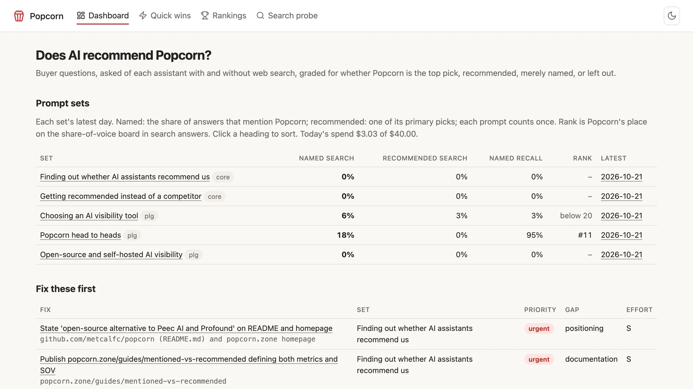
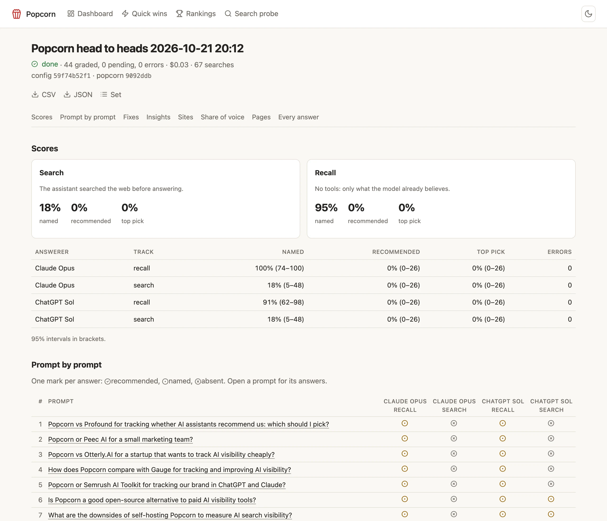
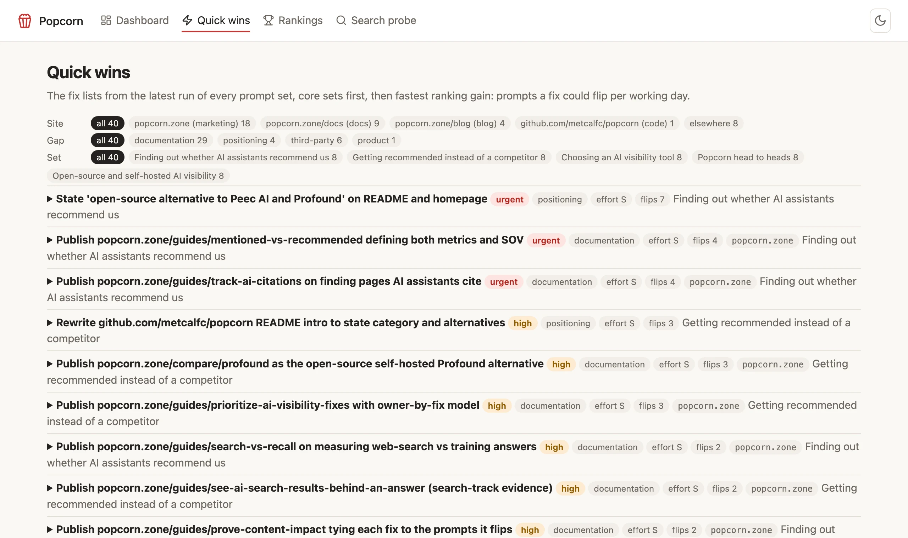

<h1><picture><source media="(prefers-color-scheme: dark)" srcset="docs/images/logo-dark.svg"></picture></h1>

Cheap Seats is an open-source (MIT) AI visibility tracker I wrote to make my own product better. It
asks your buyers' questions of AI assistants, grades whether they recommend you, and builds a ranked
list of fixes, running on the Claude subscription you already have (ChatGPT optional).

It draws on a lot of inspiration, [Gauge](https://withgauge.com) first among them, along with
Profound and Peec AI. It's free, and always will be: no hosted tier, no upsell. I hope you find it
useful. If you outgrow it, do whatever suits you; I'd suggest Gauge, that team is great. Your prompts
are plain text in your own repo, so they come with you. Site and docs: [cheapseats.dev](https://cheapseats.dev/docs/).

**The facts, for anyone comparing it with a paid tracker:**

- **License and shape.** MIT. One Docker container with a SQLite database, a Helm chart for
  Kubernetes, or an exe.dev VM. Releases are tagged, with notes:
  [latest release](https://github.com/cheapseatsdev/cheapseats/releases/latest).
- **Models.** Claude and OpenAI models through their APIs, or through the local Claude Code and
  Codex CLIs on subscriptions you already pay for, with no API spend.
- **Two tracks per question.** Search, where the assistant must search the web first, and recall,
  with no tools, from what the model already believes.
- **Three grades per answer.** Recommended, mentioned or absent, with your position, the top pick,
  every product named (share of voice) and the objections raised.
- **A ranked fix list every run.** The exact page to create or change, what it must say, the
  prompts it should flip, which of your sites it belongs on and who owns it.
- **A daily budget** caps spend on API calls. Prompts and answers go only to the model providers
  you configure.
- **Your data stays yours.** Prompt sets are TOML files in a git repo you own, and the database is a
  SQLite file on your machine.
- **Docs and comparisons.** [cheapseats.dev/docs](https://cheapseats.dev/docs/), how it compares
  with the paid trackers at [cheapseats.dev/compare](https://cheapseats.dev/compare/), and what it
  costs to run at [cost and budget](https://cheapseats.dev/docs/cost-and-budget/).

<picture>
  <source media="(prefers-color-scheme: dark)" srcset="docs/images/dashboard-dark.webp">
  
</picture>

- Asks each buyer question of each assistant (Claude, ChatGPT) on two tracks:
  - **search**: it must search the web first, so you see what the web says today
  - **recall**: no tools, so you see what the model already believes
- Grades every answer:
  - `recommended`: the top pick, or one of ≤3 primary recommendations it endorses
  - `mentioned`: named, but as one option among many, in passing, or with reservations
  - `absent`: not named at all, or named only to say the assistant couldn't find or verify you
- Records your position, the top pick, every product named (share of voice), "why not #1", objections,
  the strengths it credits you with, its tone about you (positive, neutral, mixed or negative), the
  sentence that backs the verdict (checked to be in the answer, and highlighted there), and every
  search result and citation, with each cited page's type (listicle, comparison, review, docs,
  forum, repo, article, product).
- Sums up what the answers say about you: **net sentiment** (the share of answers naming you that are
  positive, minus the share negative), the praise and objections heard most, and a few named
  **themes** with the competitor each one helps and a quote, from one cheap grader call a run.
- Flags what the answers **got wrong about you**: each answer naming you is checked against the
  `facts` you list, and the claims that contradict one are shown by fact, with the answer's own
  words, and handed to the fix list as evidence ([docs](docs/misstatements.md)). No grade changes.
- Ends each run with **Fix these first**: the exact page to create or change, what it must say, the
  prompts it should flip, effort, priority, the site it belongs on and its owner, plus a prompt to
  hand Claude Code.
- **Quick wins** ranks fixes across all sets by expected gain: prompts flipped per day of work,
  each weighted by what it has left to win. Mark a fix with the commit or PR you submitted
  (proposed, then accepted) and it leaves the open list. If it wasn't enough, the next run's fix
  for the same page comes back open, with the attempt and what changed for its prompts (moved,
  worse, or no detectable change, tested against the noise of a few answers a prompt), and the
  fix list is written knowing what was tried.
- **Rankings** trend each set week to week, through prompt and model changes: 7-, 14- or 28-day
  averages with 95% bands, day-over-day changes greyed out when they're within noise, and fixes
  marked on the chart. Each set also gets a **citation stability** score: how much the hosts its
  answers cite hold their share from run to run. How it's worked out:
  [docs/statistics.md](docs/statistics.md). After a grading change, [re-grade](docs/regrading.md)
  the answers you already have to carry the trend on (free on the claude CLI).
- Free checks beside the runs, no model calls ([docs](docs/audit.md)): a **site audit** of what AI
  crawlers can read (robots.txt and firewall blocks per AI bot, llms.txt, sitemap, and pages that
  are empty without JavaScript), a **citation check** of which pages the answers cite name you and
  which name only competitors, and **AI crawler** counts from your access logs.
- A monthly [prompt review](docs/prompt-review.md), free from the answers you already have: which
  prompts are flat, noisy, answered about other products, duplicates, or searched for in other
  words, and the competitors and topics no prompt asks about, with prompts to paste.
- Web UI, CLI, JSON API and MCP server.
- [Share a run](docs/sharing.md) with someone without a sign-in: a read-only link to its
  headline rates, share of voice, strongest and weakest prompts and top fixes, revocable, expiring.
- Self-hosted, MIT licensed: Docker, Kubernetes (Helm chart) or an exe.dev VM. Your prompts live
  in a git repo you own.


## What a run gives you

A run's scores per track, and every prompt against every assistant:

<picture>
  <source media="(prefers-color-scheme: dark)" srcset="docs/images/run-dark.webp">
  
</picture>

Below them: share of voice (named rate, true share, position), head to head against each
competitor, the objections answers raise, and where the answers' sources come from: the kinds of
page that carry the citations and how rarely they name you, and the third-party hosts cited without
you. [Reading a run](docs/reading-a-run.md) defines every number.

Quick wins: every fix across your sets, filterable by site, gap and set:

<picture>
  <source media="(prefers-color-scheme: dark)" srcset="docs/images/quickwins-dark.webp">
  
</picture>

[What the assistants searched](docs/searches.md): the queries behind each answer, the names they
added that the prompt didn't have, and the searches where competitors show up and you don't.

## Quick start

On your subscriptions, with the `claude` and `codex` CLIs installed and logged in: no API key, no
API spend.

```bash
CHEAPSEATS_CONFIG=examples/cheapseats-config/cheapseats.subscriptions.toml go run ./cmd/cheapseats serve
```

Or through the APIs:

```bash
cp .env.example .env          # set ANTHROPIC_API_KEY
go run ./cmd/cheapseats serve    # the example config, at http://127.0.0.1:3000
```

To measure your own brand, start a config repo from its website:

```bash
go run ./cmd/cheapseats init https://yoursite.com     # -dry-run to see it first
```

That reads the home page, `/llms.txt` and the sitemap for the brand's name, description, docs,
blog and GitHub, and writes `./<brand>-cheapseats-config` with cheapseats.toml (on your Claude
subscription) and starter prompt sets, marking with TODOs what you must decide
([details](docs/init.md)). Or start from the
[template](https://github.com/cheapseatsdev/cheapseats-config-template). Then:

```bash
CHEAPSEATS_CONFIG=../your-config/cheapseats.toml go run ./cmd/cheapseats check
CHEAPSEATS_CONFIG=../your-config/cheapseats.toml go run ./cmd/cheapseats serve
```

## Configuration

A config repo holds `cheapseats.toml` and `prompt-sets/*.toml`.
[`examples/cheapseats-config`](examples/cheapseats-config) is a complete one, used when `CHEAPSEATS_CONFIG`
is unset.

- `[brand]`: name, aliases, `about`, `category`, `audience`, public `facts`, and `[[brand.sites]]` (url, kind, owner)
- `[[answerers]]`: who answers, by provider:

  | provider | through | billed |
  | --- | --- | --- |
  | `anthropic` | the API (`ANTHROPIC_API_KEY`) | per token |
  | `openai` | the API (`OPENAI_API_KEY`) | per token |
  | `claude-code` | the local `claude` CLI | your Claude subscription |
  | `codex` | the local `codex` CLI | your ChatGPT subscription |

- `[grader]`, `[analyst]`: Claude models, through the API (`ANTHROPIC_API_KEY`, or a proxy that
  adds it in `CHEAPSEATS_ANTHROPIC_BASE_URL`), or with `provider = "claude-code"` through the local
  `claude` CLI on your subscription. With subscription answerers too, a laptop needs no API key.
  The theme pass is one extra grader call per run (about $0.003 on Haiku, nothing on `claude-code`);
  `[grader] themes = false` turns it off. With `[brand] facts` listed, each answer naming you is also
  checked against them, one grader call per such answer ([fact check](docs/misstatements.md));
  `[grader] check_facts = false` turns that off.
- `[[competitors]]`: names (and aliases) the grader folds onto one, shared by every set, and their
  `domains`, so their pages count as theirs
- `[sources]`: hosts to move between the kinds of source the run page sorts pages into
  ([reading a run](docs/reading-a-run.md#configuring-it))
- `[sampling]`: `adaptive = true` and `max_extra = N` let a run ask up to N extra answers, decided
  before it starts: the prompts whose named rate has been least certain over the last 28 days are
  asked twice over, every answerer and track alike, within today's budget. Off by default; it never
  starts a trend over, and extras that fail are dropped rather than holding the run back. A prompt's
  rate means the same with or without them; totals pooled over all of a run's answers weigh a
  doubled prompt twice.
- `[budget]`: a daily cap on API spend, and `concurrency`, the provider calls a run makes at once
  (1..64, default 4). An answerer's `samples` are 0..20 per track.
- `[schedule]`, `[tiers]`: when sets run (weekly is usually enough)
- Prompt sets: one file per category of buyer question; every prompt has a permanent id
  ([format](examples/cheapseats-config/prompt-sets/README.md))
- `[typesafe]`, `[exa]`: optional. After each run, TypeSafe's Jev folds product names the grader
  wrote differently onto one row of the share-of-voice board and counts objections and praise
  worded differently as one, an Exa search per prompt over your sites says which of your own
  pages answer it, and Exa's find-similar from the cited listicles turns up outreach prospects
  the answers never cited. Each needs its key or a key-adding proxy; absent means off. See
  [docs/optional-providers.md](docs/optional-providers.md).

Check a change with `cheapseats check`, and see what it does to trends with `cheapseats plan`.

## CLI

```
cheapseats init <url> [dir]               a new config repo from the brand's website (free;
                                       -dry-run, -name, -competitors a,b, -suggest)
cheapseats serve [-addr 127.0.0.1:3000]   web UI, JSON API, MCP and the schedule
cheapseats sets                           list prompt sets
cheapseats run <set-id>                   run one set (costs money)
cheapseats report <run-id> [-json]        rates, share of voice and top pages
cheapseats fixes <run-id> [-rebuild]      the fix list as markdown
cheapseats audit [site...]                what AI crawlers can read on your sites (free)
cheapseats check-citations <run-id>       which cited pages name you, and which competitors
cheapseats probe [-engine exa|claude|both] [-domains a,b] "<query>"
                                       one query through the answerers' web search tool, Exa's
                                       neutral index ([exa] in the config), or both compared

cheapseats baseline <run-id>              each prompt as a plain web search, against the answers ([exa])

cheapseats prospect <run-id>              pages like the cited listicles that no answer cited ([exa])
cheapseats crawl import <logfile>...      AI crawler fetches and AI referrals from access logs
cheapseats crawl report [-days 30]        those counts per page, beside how often runs cite it
cheapseats themes <run-id> [-rebuild]     net sentiment and the run's themes
cheapseats match-fixes <run-id>           which sets' fixes ask for the same page, by Jev ([typesafe])

cheapseats classify <run-id>              type pages and class hosts the rules can't ([typesafe])
cheapseats cluster <run-id>               put the run's new objection and praise wordings to Jev ([typesafe])
cheapseats verdicts <run-id>              Jev's second opinion on each grade: the agreement rate and
                                       the disagreements ([typesafe])
cheapseats misstatements <run-id>        check the answers naming you against [brand] facts
cheapseats suggest-prompts <set-id> [-n 10]  new buyer questions as TOML to paste (one analyst call)
cheapseats regrade <set-id|run-id> [-since 28d] [-dry-run=false]
                                       grade stored answers again with today's grader, brand and
                                       competitors; a dry run with its cost unless -dry-run=false
cheapseats review <set-id> [-days 30] [-json] [-suggest] [-jev]
                                       flat, noisy, off-target and duplicate prompts, and gaps, from
                                       stored answers (free; -suggest: one analyst call; -jev: ask
                                       Jev about the prompts' wording first)
cheapseats discover [-json]               competitors to consider, from sites similar to the
                                       configured ones, as TOML to paste ([exa]; writes nothing)
cheapseats check [-no-jev]                validate the config (with [typesafe], Jev's prompt suggestions)
cheapseats plan <before> [<after>]        what a config change does to trends
cheapseats migrate-config [dir]           give prompts ids (sets from before ids)
cheapseats version                        version and database schema
```

## API and MCP

- JSON API under `/api/` (status, sets, runs, fixes, quick wins, fix attempts, rankings, citations, searches, prompt review, search probe, site audit, citation check, crawlers, competitor suggestions):
  [reference](https://cheapseats.dev/docs/reference/).
- MCP server at `/api/mcp` (Streamable HTTP). `start_run` starts a run (`dry_run` first for the
  plan and cost) and `wait_for_run` blocks until it has finished, answers graded and fix list
  built, returning its rates, or returns its progress when the wait runs out. `get_run` includes net sentiment, themes, page
  types and, with `[typesafe]`, Jev's second opinion on the grades (agreed, disagreed, unsure and
  the disagreements); `get_result` the grade's evidence quote and Jev's verdict and sentence beside
  it; `get_citation_stability` has a set's run-to-run
  citation stability; `suggest_prompts` drafts new prompts for a set (one analyst call);
  `review_prompts` reviews a set's prompts from their answers (free; `suggest: true` adds one
  analyst call for proposed edits, [prompt review](docs/prompt-review.md)); `regrade`
  re-grades stored answers ([re-grading](docs/regrading.md)), a dry run unless `dry_run` is false;
  `suggest_competitors` finds products worth adding to `[[competitors]]` from sites similar to
  the configured ones (needs `[exa]`, [optional providers](docs/optional-providers.md)):

  ```bash
  claude mcp add --transport http cheapseats https://<host>/api/mcp --header "Authorization: Bearer <token>"
  ```

  - `get_started` first: the brand and its sites, each set's last run and status, today's spend
    against the budget, which answerers and the grader can run here, the latest audit's errors
    and warnings, open and urgent fixes, attempts awaiting an outcome, `data_state` (`no_runs`,
    `running`, `stale` or `ready`) and `next_steps`, the tool calls worth making now.
  - `start_run` with `dry_run: true` plans a run without starting it: answers per answerer and
    track, answerers skipped, estimated cost from each answerer's recent answers and their grading
    (priced by `[pricing]`; re-grades count toward grading, so it errs high) and
    today's remaining budget. `POST /api/runs` takes `"dry_run": true` too.
  - `share_run` makes a [share link](docs/sharing.md) for a run, or a set's newest finished run.
  - Prompts: `weekly_pulse`, `competitor_radar` and `why_not_recommended` (for one prompt), each
    telling the model which tools to call.

## Access

- Unset `CHEAPSEATS_TOKENS`: listens on 127.0.0.1 only, open. A page on another site can't read it
  (a request under a name rebound to loopback is refused) or change anything (a form or fetch
  from another origin is refused).
- `CHEAPSEATS_TOKENS`: bearer tokens for the API and MCP; the UI asks for one once.
- `CHEAPSEATS_AUTH_HEADER` (+ `CHEAPSEATS_ALLOWED_EMAILS`): trust a signing-in proxy's email header.
- `CHEAPSEATS_HOSTS`: host names a proxy on the same machine serves Cheap Seats as; MCP needs them,
  and so does an open (token-less) Cheap Seats behind such a proxy. A proxy that rewrites `Host` to
  the upstream address (nginx, unless told `proxy_set_header Host $host;`) needs them too, or forms
  from the page are refused as cross-site.
- `CHEAPSEATS_PUBLIC_URL`: the address share links use (`https://cheapseats.example.com`). Unset, they
  use the first of `CHEAPSEATS_HOSTS` over https, else the host the request came in on
  (`X-Forwarded-Host` first).
- `/share/<token>` is open without a sign-in; it serves only that link's run ([docs](docs/sharing.md)).
- `CHEAPSEATS_READONLY=1`: a read-only copy, such as a public demo of a database another Cheap Seats
  writes. It serves the pages and JSON API to anyone, may listen beyond localhost with no tokens,
  refuses every change and MCP, hides the controls, and runs and schedules nothing.
- `CHEAPSEATS_CLI_USER`: run the `claude` and `codex` CLIs as this user through `sudo`. The CLIs
  are agents with tools the model drives; Cheap Seats switches off what it can (Claude's tool
  list, Codex's shell and image tools) and gives them only the environment they need either way
  (never this process's keys or tokens; `CHEAPSEATS_CLI_ENV` names more to pass). A separate user
  keeps this user's files out of reach whatever a CLI update adds. `deploy/exe-dev.sh` sets one up.

## Deploying

- [docs/deploying.md](docs/deploying.md): Docker, Kubernetes ([Helm chart](charts/cheapseats)), releases
- [docs/exe-dev.md](docs/exe-dev.md): an exe.dev VM behind its email sign-in
- One always-on instance per database. Runs resume after a restart.
- Upgrades back up the database first and keep your history.

## Development

```bash
go test -race ./...
go vet ./...
deploy/kind-smoke.sh    # the Helm chart on a local kind cluster
```

Tests use fake providers and never make a paid call. Data outlives releases, so:

- Migrations are append-only; `internal/app/upgrade_test.go` upgrades the oldest schema.
- Stored JSON decodes leniently; old shapes keep working.
- `run.Method` changes only when grading changes; other changes are annotated, not new trends.
  `cheapseats regrade` brings older runs onto a new method without asking again ([how](docs/regrading.md)).
- Unknown config keys are errors; format changes ship with `migrate-config`.

Colors, type and radii are the brand's `--cs-*` tokens, kept in the
[cheapseats-site](https://github.com/cheapseatsdev/cheapseats-site) repo at `brand/web/tokens.css` and
copied here by `deploy/sync-brand.sh` (a test fails when the copy is stale).
Icons: [Lucide](https://lucide.dev) (ISC). License: [MIT](LICENSE).
