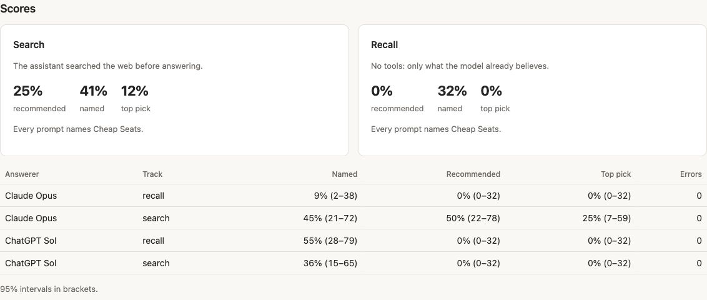

<h1><picture><source media="(prefers-color-scheme: dark)" srcset="docs/images/logo-dark.svg"></picture></h1>

Cheap Seats is an open-source (MIT), self-hosted AI visibility tracker. It asks Claude and OpenAI
models your buyers' questions, grades each answer recommended, mentioned or absent, and builds a
ranked fix list. One container with SQLite, and a web UI, CLI, JSON API and MCP server. Use Docker
with API keys, or run locally with Go to use your Claude subscription (ChatGPT optional).

**What it measures.** Cheap Seats supports two tracks: **search** requires web retrieval before
answering and records searches, returned URLs and citations; **recall** uses no tools, so you see
what the model already believes. It doesn't reproduce consumer-app answers or cover Gemini,
Perplexity, Google AI Overviews, AI Mode or Microsoft Copilot. Cheap Seats avoids consumer-app
scraping dependencies ([why](https://cheapseats.dev/docs/engines/#why-not-scrape-the-consumer-apps)).
Model access, hosting and optional services have their own costs. [Docs](https://cheapseats.dev/docs/) · [Live demo](https://demo.cheapseats.dev/)
· [Compare tools](https://cheapseats.dev/compare/) · [Latest release](https://github.com/cheapseatsdev/cheapseats/releases/latest).

## Quick start

**Use Go with subscriptions, or Docker for the quickest setup with API keys.**

| How you access models | Setup | What you need |
| --- | --- | --- |
| API keys | [Docker](#docker-with-api-keys) | Docker, Git and `ANTHROPIC_API_KEY`; `OPENAI_API_KEY` is optional. No Go installation. |
| Claude subscription (ChatGPT optional) | [Go](#go-with-subscriptions) | Go 1.27 or later, an app checkout and an installed, logged-in `claude` CLI; `codex` is optional. |

### Docker with API keys

Clone the config template; the published image supplies the app:

```bash
git clone https://github.com/cheapseatsdev/cheapseats-config-template cheapseats-config
cd cheapseats-config
umask 077
printf 'CHEAPSEATS_TOKENS=%s\n' "$(openssl rand -hex 32)" > .env
"${EDITOR:-vi}" .env
```

Keep the generated token and add `ANTHROPIC_API_KEY=<your key>` in the editor.
Add `OPENAI_API_KEY=<your key>` for OpenAI answers; otherwise that answerer is skipped.
The template ignores `.env` in git. Then start the container:

```bash
docker run --rm --name cheapseats --stop-timeout 30 \
  -p 127.0.0.1:3000:3000 \
  --env-file .env \
  -v "$PWD:/config:ro" \
  -v cheapseats-data:/data \
  ghcr.io/cheapseatsdev/cheapseats:0.5.3
```

Open <http://127.0.0.1:3000> and sign in with the token from `.env`. The named volume keeps
your results after the container stops. The image includes neither subscription CLI.
**API runs cost money:** review model IDs, prices and budget before starting a set. The budget
admits calls against estimated reservations; actual charges can exceed them. See
[cost and budget](https://cheapseats.dev/docs/cost-and-budget/).

### Go with subscriptions

From an app checkout, with Go 1.27 or later and the `claude` CLI installed and logged in:

```bash
CHEAPSEATS_CONFIG=examples/cheapseats-config/cheapseats.subscriptions.toml go run ./cmd/cheapseats serve
```

Open <http://127.0.0.1:3000>, choose a set and run it. Claude handles answers, grading and
analysis; an installed, logged-in `codex` CLI adds OpenAI answers. These calls share your
subscription allowances, with no API key or API spend.

This Go setup listens on loopback without authentication: every local user or program can read
results and start runs. Set `CHEAPSEATS_TOKENS` on shared machines; see [Access](#access).

### Measure your own brand

Both quickstarts measure Cheap Seats itself. **Docker/API users:** edit `cheapseats.toml` and
`prompt-sets/` in the template you cloned, then restart the container. Keep its API providers;
[Docker setup and validation](docs/deploying.md#try-docker-with-api-keys) need no Go.

**Go/subscription users:** generate a config from your website, then review its TODOs, brand,
audience, facts and buyer questions before checking and serving it:

```bash
go run ./cmd/cheapseats init https://yoursite.com ../your-config
# Review ../your-config before continuing; add -dry-run to init to preview it first.
CHEAPSEATS_CONFIG=../your-config/cheapseats.toml go run ./cmd/cheapseats check
CHEAPSEATS_CONFIG=../your-config/cheapseats.toml go run ./cmd/cheapseats serve
```

`init` reads public pages and writes starter prompts without model calls unless you add `-suggest`.
See [config generation](docs/init.md) for what it reads and writes, and
[Getting started](https://cheapseats.dev/docs/getting-started/) for the full walkthrough.

## What a run gives you

Each available assistant answers on the enabled tracks, for the configured samples:

| Track | How it answers | Evidence kept |
| --- | --- | --- |
| Search | Must search the web before answering | Queries, returned URLs, answer and citations |
| Recall | No tools | Answer |

A separate Claude call grades each answer and checks its evidence quote against the answer text:

| Grade | Meaning |
| --- | --- |
| `recommended` | Top pick or one of at most three primary recommendations actively endorsed |
| `mentioned` | Product information, but only in passing, as one option among many or with reservations |
| `absent` | Not named, a namesake, or a name-only disclaimer without product information |

Named rates use all graded answers; recommended and top-pick rates use choice-question answers.
Run rates pool answers; ranking trends average prompts. Share of voice divides your product's
answer mentions by all products' answer mentions, counting each product once per answer.
A returned URL does not prove its page was read, and a
citation does not establish endorsement. [Grading](https://cheapseats.dev/docs/how-grading-works/) · [Metric definitions](https://cheapseats.dev/docs/metrics/).

<details>
<summary>See a run's scores</summary>

<picture>
  <source media="(prefers-color-scheme: dark)" srcset="docs/images/readme-run-scores-dark.jpg">
  
</picture>

Captured from the [public demo](https://demo.cheapseats.dev/runs/r-20261024-222715-986b58) on
24 October 2026. Named and recommended can use different denominators.

</details>

- **Inspect the evidence:** position, top pick, objections, net sentiment, themes, competitors
  and sources. [Read a run](docs/reading-a-run.md), [inspect searches](docs/searches.md), or
  [check claims against your listed facts](docs/misstatements.md).
- **Choose work:** fix briefs name a page, required content, target questions, effort and owner.
  Quick wins ranks them across sets by prompts reached per working day, weighted by remaining
  headroom. Mark a commit or PR to track an attempt.
- **Measure later:** named, recommended and top-pick rates have 95% intervals. Fix outcomes compare
  target prompts on comparable runs, after at least seven days and four later answers per target
  prompt on average. These gates do not guarantee precision; no detectable change is not zero
  effect, and before/after does not prove cause. [Statistics and outcomes](docs/statistics.md).
- **Check without model calls:** [site audit, citation checks and crawler-log reports](docs/audit.md).
  Optional Exa fallback page reads can cost money. [Prompt review](docs/prompt-review.md) uses stored
  answers; suggested edits and Jev checks are optional calls.

## Configuration

Keep `cheapseats.toml` and `prompt-sets/*.toml` in your own git repo. The complete
[example](examples/cheapseats-config) is used when `CHEAPSEATS_CONFIG` is unset.

| Provider | Access | Billing |
| --- | --- | --- |
| `anthropic` | `ANTHROPIC_API_KEY` | API usage |
| `openai` | `OPENAI_API_KEY` | API usage |
| `claude-code` | Local `claude` CLI | Claude subscription |
| `codex` | Local `codex` CLI | ChatGPT subscription |

`[grader]` and `[analyst]` use Claude, by API or `claude-code`. Configure each role; subscription
answerers alone do not make API grading free.

The config also holds your brand and sites, competitors and aliases, source classifications,
prices, budget, schedule and samples. Prompts have stable IDs that preserve their history.
Optional adaptive sampling adds answers for uncertain prompts in core sets; it is off by default.
See [configuration and sampling](https://cheapseats.dev/docs/configuration/) and the
[prompt-set format](examples/cheapseats-config/prompt-sets/README.md).

Prompts, answers and configured brand context go to the services you enable. Keep private material
out of public `about` and `facts`. Optional Jev and Exa passes need keys or key-adding proxies and
are off without configuration; they can receive answers, prompt text, names and page data.
[Provider boundaries](docs/optional-providers.md) · [Data and privacy](https://cheapseats.dev/docs/reference/#data-and-privacy).

## CLI

Use `go run ./cmd/cheapseats` in a checkout, or the `cheapseats` release binary. Common commands:

```text
cheapseats sets                       # list prompt sets
cheapseats run <set-id>               # collect and grade answers; uses subscriptions or paid APIs
cheapseats report -json <run-id>      # rates, share of voice and top pages
cheapseats review <set-id>            # review prompts from stored answers
cheapseats regrade <set-id>           # dry run before replacing stored grades
cheapseats backup <file>              # consistent SQLite copy, safe while serve runs
```

Check config with `cheapseats check`; preview a change with `cheapseats plan <before> [<after>]`.
The [CLI reference](https://cheapseats.dev/docs/reference/#cli) covers all commands and flags,
including audits, search probes, discovery and optional provider passes.

## API and MCP

The [JSON API](https://cheapseats.dev/docs/reference/#json-api) is under `/api/`; the
[MCP server](https://cheapseats.dev/docs/reference/#mcp-server) uses Streamable HTTP at `/api/mcp`:

```bash
claude mcp add --transport http cheapseats https://cheapseats.example.com/api/mcp --header "Authorization: Bearer <token>"
```

Call `get_started` for status and next steps. Use `start_run` with `dry_run: true` to check planned
answers, skipped answerers, estimated cost and remaining budget before starting a run. An estimate
is not a quote. `regrade` also defaults to a dry run.

## Access

- **Local:** the default setup lets every local user or process read answers and start runs.
  `CHEAPSEATS_TOKENS` supplies bearer tokens for API/MCP; the web UI asks once.
- **Remote:** serve over HTTPS. A sign-in proxy can use `CHEAPSEATS_AUTH_HEADER`, narrowed by
  `CHEAPSEATS_ALLOWED_EMAILS`; these settings must come from the real environment, not `.env`.
  Same-machine proxies need `CHEAPSEATS_HOSTS`. Set `CHEAPSEATS_PUBLIC_URL` for share links.
  [Auth and proxy rules](https://cheapseats.dev/docs/reference/#access).
- **Share one run:** use an [expiring, revocable report link](docs/sharing.md). Anyone holding it
  can view that report without signing in.
- **Public copy:** `CHEAPSEATS_READONLY=1` disables writes, MCP and scheduling; it does not redact
  copied data or change configured authentication. Without tokens or proxy authentication,
  anyone can read it. Review the database and config before publishing. [Publication boundaries](https://cheapseats.dev/docs/read-only-copy/).
- **CLI isolation:** the CLIs are agents with tools. Cheap Seats restricts tools and environment;
  a CLI update can change what is reachable. Use `CHEAPSEATS_CLI_USER` for a separate user on
  sensitive machines. `CHEAPSEATS_CLI_ENV` is an explicit environment allowlist, set outside `.env`;
  startup variables are refused. [Isolation details](https://cheapseats.dev/docs/reference/#cli-answerers).

## Deploying

[Docker or Kubernetes](docs/deploying.md) · [Helm chart](charts/cheapseats) · [exe.dev VM](docs/exe-dev.md).

Run one always-on instance per SQLite database. Runs resume after restarts. Use `cheapseats backup`
for a consistent copy; copying a live database file can miss writes in its WAL. Upgrades back up
the database first, preserve history and refuse a database from a newer schema.

## Development

```bash
go test -race ./...
go vet ./...
deploy/kind-smoke.sh    # optional: Helm chart on a local kind cluster
```

Tests use fake providers and make no paid calls. Migrations are append-only; stored JSON decodes
leniently, and config format changes ship with `migrate-config`.

`run.Method` covers the answer prompt, search policy, CLI answerers' arguments, grader
prompt/model, and the brand's name, aliases and `about`.
Competitor changes affect grading inputs without themselves changing `Method`. Re-grading preserves
answers, original dates and replaced grades; it cannot repair a different answer prompt or search
policy, and does not rebuild fixes or themes automatically. [Re-grading](https://cheapseats.dev/docs/regrading/).

Brand tokens live in [cheapseats-site](https://github.com/cheapseatsdev/cheapseats-site) at
`brand/web/tokens.css`; sync with `deploy/sync-brand.sh`. Icons: [Lucide](https://lucide.dev) (ISC).
License: [MIT](LICENSE).
