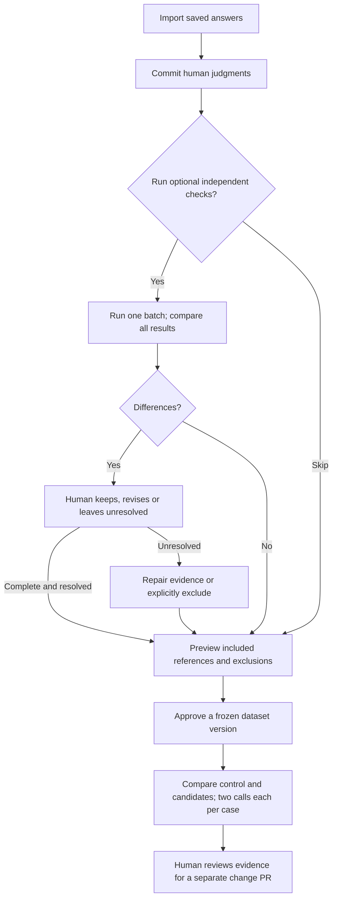
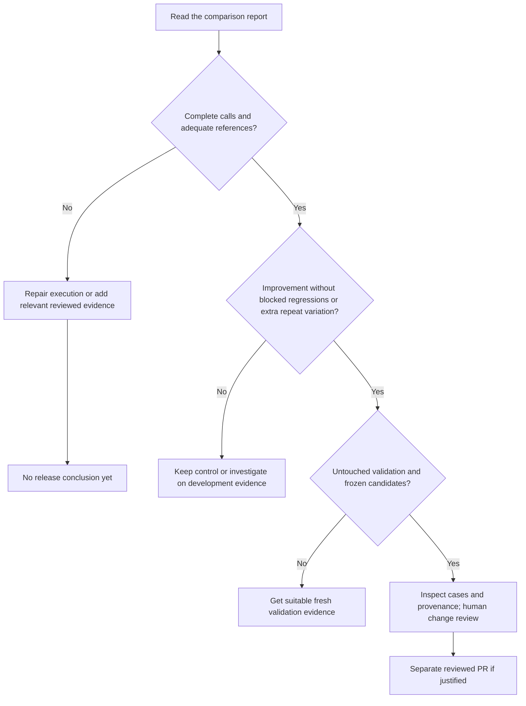

# Choosing and running evaluations

An evaluation should answer a specific question before you change anything. For
grading, the question is whether we interpret saved answers correctly—not whether
we can get a higher visibility rate by changing buyer questions.

The Evaluation workbench is an **unreleased preview**, off by default and absent
from the 0.6.0 image. This branch includes the work through
[saved-run imports, PR #161](https://github.com/cheapseatsdev/cheapseats/pull/161).
Use [the technical guide](evaluation.md#try-the-review-workflow-locally) for setup,
`CHEAPSEATS_EVALUATION=1`, private data directories and exact commands.

Until the website publishes these guides, use the repository previews for the broader product workflow:
[AI visibility, AEO and GEO](https://github.com/cheapseatsdev/cheapseats-site/blob/6c74c37/content/docs/understanding-ai-visibility.md),
[choosing buyer questions](https://github.com/cheapseatsdev/cheapseats-site/blob/6c74c37/content/docs/choosing-questions.md), and
[which check to run](https://github.com/cheapseatsdev/cheapseats-site/blob/6c74c37/content/docs/checks-and-evaluations.md).

## Choose the question first

| Question | Operation | What it changes |
| --- | --- | --- |
| What do assistants answer now? | A buyer run | Collects new dated answers and grades |
| Is this saved grade correct? | Human review | Saves a separate judgment and evidence, leaving production grades intact |
| Does another assessment disagree? | Optional independent check | Adds model evidence for a human decision; cannot approve its own label |
| Which references are fixed for a test? | Approve a dataset version | Freezes membership, labels, rules, partitions and exclusions |
| Would a different grader be better? | Grader comparison | Runs the control and candidates against frozen references |
| Should historical answers use the intended new grading inputs? | [Re-grade](regrading.md) | Explicitly updates stored grades, preserving answers, dates and replaced grades |

A **rubric** is the written grading rule. A **reference** is a human-reviewed label.
The **control** is the saved production grading prompt; a **candidate** is a
proposed alternative. **Development** cases can inform tuning; **held-out** cases
must remain unused for tuning before validating a frozen candidate. A **baseline**
such as always predicting absent exposes whether a benchmark can distinguish a
useful classifier from a weak one.

A **class** is one category within a scored field, such as recommended, namesake-only
true, or negative tone. Class coverage counts the reviewed references in those
categories. It is different from coverage of web pages or buyer situations.

## Follow the evidence from review to a decision

1. **Import and review.** Choose **Add answers from a saved run**, a private JSONL
   file, or the bundled example. Read the complete answer and recorded identity;
   use **Save and next**. Drafts are unfinished work. No-reference absence needs
   whole-answer confirmation; echo/namesake absence needs the deciding quote.
2. **Optionally check the finished judgments.** Choose **Run checks for all N**.
   Follow progress to the combined comparison. Agreements need no extra save;
   resolve differences with a human explanation, revise, or leave unresolved.
3. **Approve references.** Choose **Preview dataset version**, inspect membership,
   and explain exclusions. Only complete, current judgments without running checks
   or pending differences can be included. Download JSONL and the full manifest.
4. **Test a candidate on development evidence.** Keep the model, rubric meaning
   and source evidence fixed. Preview the calls and budget, then explicitly run.
   Each grader runs twice; compare per-class errors and repeated-run variation.
5. **Validate and decide.** Freeze candidates before using untouched held-out
   evidence. Inspect paired regressions, reference coverage and practical value.
   Record a supported decision to retain or propose changing the grader.

Import, manual review, approval, export and saved reports make no model calls.
Explicit checks and comparisons require configured provider access, using API
charges or subscription allowances. Admission budgets are not hard billing caps.
Opening a preview never starts paid calls. No workbench result deploys a prompt,
updates golden fixtures or changes production grades automatically.

## Interpret the result before running again

| Result | Interpretation and next step |
| --- | --- |
| Agreement | Keep the human reference; matching model labels do not add another human review |
| Difference | Inspect the whole answer and deciding rule; keep or revise with a reason, or leave unresolved |
| Incomplete predictions | Provider/parse failures remain unknown and retain their planned denominator; repair and resume explicitly |
| Insufficient coverage | Add relevant reviewed cases; two examples per core class is only a software floor, not a reliability claim |
| Critical-class failure | A represented important class has zero recall; aggregate agreement cannot rescue it |
| Regressions or uncertain gain | Investigate the actual errors and variation; retain the control when evidence does not justify change |
| Conservative prerequisites met | Eligible for human release review, not statistical proof, semantic-support proof or automatic deployment |

Recall asks which reference cases of a class were found. Precision asks which
predictions of that class were correct. Inspect both with their counts. The four
core fields are verdict, top pick, namesake-only and tone; quote checks establish
occurrence, not whether the quote logically justifies the label.

## When to use it

| Signal | Useful action |
| --- | --- |
| First use or unfamiliar answer type | Run a small human-review pilot before scaling |
| Suspicious grade or recurring disagreement | Review the saved evidence; optionally batch-check it |
| New data or weak class coverage | Add relevant cases and reuse existing human judgments |
| Before a grader prompt/model/normalization change | Compare fixed control/candidates against approved references and run required developer checks |
| An active deployment's periodic review | Inspect a manageable sample, for example monthly, guided by risks and recent changes |

This is suggested operating guidance, not automatic scheduling. There is no
universal requirement to review 80 answers or finish a whole corpus in one sitting.
Use a pilot, inspect coverage and review the whole set when manageable. The bundled
80 records are only a worked example; their initial labels are model proposals.

Evidence used for tuning cannot become fresh validation through reimport or a new
dataset version. Revised reference labels require a new frozen version and new
comparison. Do not keep tuning against held-out disputes until a gate passes.

**Success is a defensible decision with explicit uncertainty**, including retaining
the current grader or leaving a case unresolved. A high percentage, extra judge,
longer prompt or model agreement alone is not that decision. After a separately
reviewed change ships, [re-grade eligible history](regrading.md) if needed; collect
new buyer answers to observe current visibility.

The legacy [real-provider golden check](grading.md#running) is a separate developer
check against stored labels. Ordinary tests use fake providers. Neither substitutes
for sound human references, and exporting a workbench version updates neither CI
nor the production prompt by itself. A separate Next steps advice benchmark remains
proposed work; its units and decisions differ from visibility grades.
