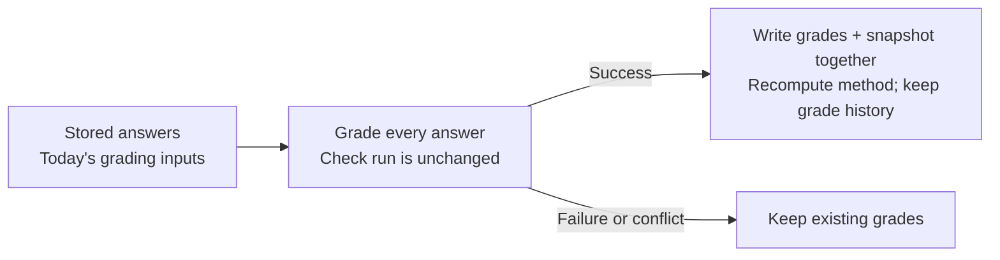

# Re-grading

Update grading without asking the assistants again. [Rubric and tests](grading.md).

```bash
cheapseats regrade <set-id|run-id>                     # dry run: work and estimated cost
cheapseats regrade <set-id|run-id> -since 90d -dry-run=false
cheapseats regrade <set-id|run-id> -force             # dry run, including runs already graded today's way
```



Original answers and dates stay intact. Re-graded runs can join today's trend when only grading
changed; a different answer prompt or search policy needs a new baseline.

- **Scope:** a set's finished runs within `-since` (`28d`, `72h` or `all`; default 28 days),
  or one named run. Running and unfinished runs are skipped, as are runs whose grading inputs
  already match today's (unless `-force`) or whose answer prompt, search policy or CLI arguments
  differ.
- **Forcing:** a fix to the grading code itself, such as post-processing in
  `internal/grade/grade.go`, changes grades without changing the grading inputs, so a plain
  re-grade calls those runs already graded and skips them. `-force` re-grades them too. Its dry
  run says how many runs and answers it adds and what they cost (`forced_runs`,
  `forced_answers`, `forced_usd` in JSON), and marks those runs `unchanged (forced)`. Their
  method stays the same, so they stay in their trend. Runs asked differently are still skipped:
  forcing can't join them to today's trend.
- **Inputs:** `run.GradeInputs` fingerprints grader prompt/model, brand name/aliases/`about`,
  and competitor names/aliases. Competitor edits can require re-grading without changing
  `run.Method`. The method also covers how answers were asked; re-grading cannot change that.
- **Cost:** one grader call per answer. `claude-code` records $0 API spend on your subscription.
  API dry runs estimate tokens (about four characters per token, plus thinking) using `[pricing]`.
  A run whose estimate exceeds the remaining daily admission budget is not started; actual
  calls also reserve against it. This is not a hard provider billing ceiling.
- **History:** replaced grades stay in `results.grade_history`, forced or not. The API's
  `regrades` records date, answer count, cost, previous method and grader, and `forced` when the
  run was already graded with today's inputs; the run page labels the re-grade. Re-grading only some runs moves the trend break to before the oldest one.
- **Fix outcomes:** run the re-grade yourself, through the CLI, UI or MCP. An outcome marked
  **needs regrade** names the required runs (`regrade_runs`) and lookback (`regrade_since_days`):
  the fix's run, its pooled baseline and later runs on older grading methods. Run and quick-win
  links prefill that range; `get_started.next_steps` supplies the per-set call. The next listing
  measures the outcome once comparable grades are available. A different answer prompt or search
  policy leaves it **not comparable**. See [fix outcomes](statistics.md#fix-outcomes).
- **Not rebuilt:** fix lists, themes and [fact checks](misstatements.md) stay as they were.
  To refresh them, use `cheapseats fixes -rebuild <run-id>`,
  `cheapseats themes -rebuild <run-id>` and `cheapseats misstatements <run-id>`.

The set page's **Re-grade stored answers** shows runs, answers, method changes and estimated
cost before starting work in the background; it has no force option, so use the CLI or MCP for
that. MCP `regrade` takes `target` (set or run), `since_days` (default 28, 0 for all; negatives
fail), `dry_run` (true unless explicitly false) and `force` (false unless true).
