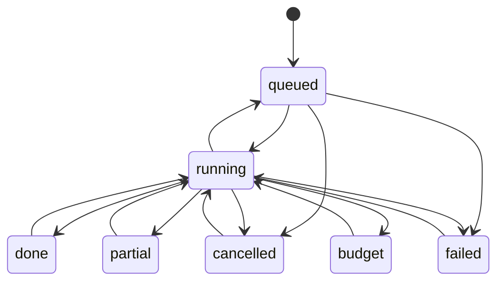
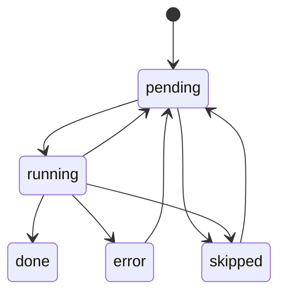
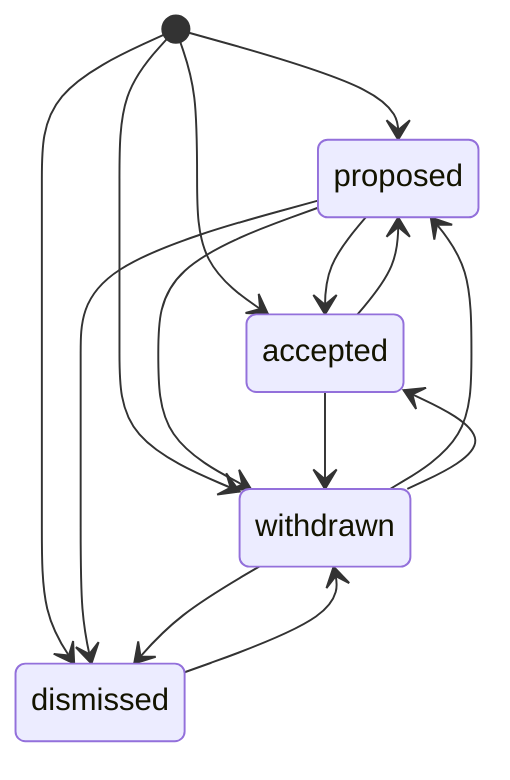
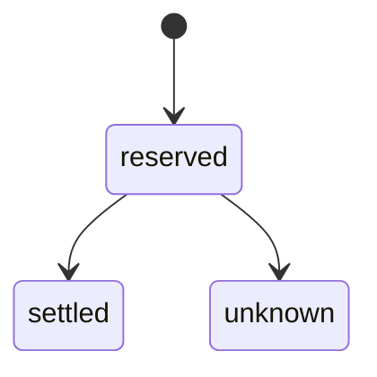
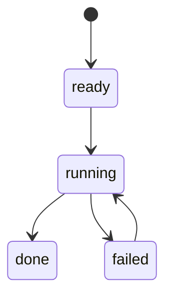
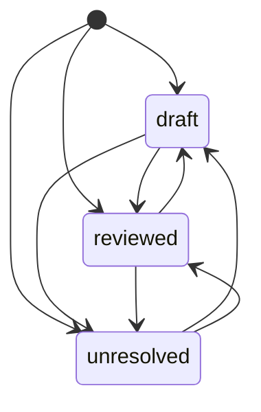

# States

How runs, results, fix attempts, budget reservations and evaluation checks move between statuses. The
status columns are text; these are their values, and the arrows are every move the code makes.

Generated from the transition tables in the code (`run.RunTransitions`, `run.ResultTransitions`,
`app.AttemptTransitions`, `budget.Transitions`, `evaluation.CheckTransitions`, `evaluation.ReviewTransitions`) by
`go test ./internal/app -run TestStatesDocIsCurrent -update`; the test fails while this file is
stale. Every status write goes through a helper that checks the move against its table, and the
`run` package's tests fail on a move the table doesn't list.

## Runs (`runs.status`)

A run is **queued** when created and **running** while a process answers and grades it; one run
per set is queued or running at a time. It ends **done** (every result graded: it counts in
rankings, trends and the fix list), **partial** (results unfinished after the one more try at
failed answers), **budget** (the daily budget stopped it), **failed** (a storage failure, or a
resume this version would ask or grade differently) or **cancelled**.

A shutdown records a running run as queued with the error `interrupted by a restart; resuming`;
a crash leaves it running, and the next start's Recover re-queues it the same way. Resume takes
queued runs from there, keeping the answers they have. Retry runs an ended run again from where
it stopped; the page offers it when results are unfinished, the API takes it for any run.

## Results (`results.status`)

Each answer to ask for is **pending** when the run is created, **running** while it's answered
and graded, then **done** (graded) or **error** (the answer or the grade failed; `error` says
why). What the run ends before reaching is **skipped**, as is an answer whose answerer has no
key. A resume or retry asks again for whatever isn't done; an answer saved but not graded is
graded without being asked again. A re-grade rewrites grades and never a status.

## Fix attempts (`fix_attempts.state`)

Work submitted for a fix is **proposed** (a commit or pull request is up), **accepted** (it
merged) or **withdrawn** (closed, which reopens the fix). An attempt can be recorded in any
state and moved to any other, since a pull request can be reopened or a merge reverted. A fix
the team won't do is **dismissed**, with the reason as its note and no link; a dismissal can
only be withdrawn, which undoes it, and merged work must be withdrawn before its fix is dismissed.

## Budget reservations (`spend_events.state`)

Every billable call is **reserved** against today's budget before it's made, then **settled** at
its known cost, or left **unknown** at the larger of the cost and the reservation when the cost
can't be known. A process that dies between the two leaves the reservation standing.

## Independent checks (`evaluation_checks.state`)

An explicit request creates a **ready** check. A worker claims it as **running**, then records
**done** with a model assessment or **failed** without a fabricated prediction. Done results
are reused. A failed check can be retried explicitly once; a crashed running worker can be
reclaimed after its lease expires. The lease fences late results, and the fixed admission
budget covers both assessment attempts and their transport retries. Human judgments and
resolution events are stored separately; none of these states is human approval.

Comparison predictions (`evaluation_predictions.state`) use the same check lifecycle, with
each case, grader and repetition claimed and saved separately. Done predictions survive resume.

## Evaluation decisions (`evaluation_reviews.state`)

A human decision starts as **draft**, **reviewed** or **unresolved**. Draft is unfinished work,
reviewed is an explicit validated judgment, and unresolved records the decision still needed.
Each change appends history and requires the previous revision. Comparison reviews use reviewed
or unresolved in `evaluation_experiment_reviews.state`; their unfinished edits stay in the
browser rather than autosaving over the human reference. Approved dataset versions stay frozen.

