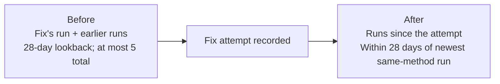

# Reading trends and outcomes

A few answers per prompt can produce large rate changes by chance. Cheap Seats estimates
uncertainty from stored answers, with no extra model calls. A reading's interval and a change's
interval answer different questions; neither establishes what caused a change.

## The building blocks

For trends and outcomes, prompts are the units: rates average each prompt's rate equally,
even if some prompts have more answers. Run-report rates instead pool answers. A cell is one
prompt's `h` hits out of `n` answers, with observed rate `p = h/n`.

**Cell variance.** Smoothing keeps a cell of 0/6 or 6/6 from claiming no noise:

```math
\begin{aligned}
\tilde p &= \frac{h + 0.5}{n + 1} \\
v &= \frac{\tilde p(1 - \tilde p)}{n}
\end{aligned}
```

**Change.** For `K` prompts measured on both sides, `a` means after and `b` before:

```math
\begin{aligned}
D &= \frac{1}{K}\sum_{k=1}^{K}(p_{a,k} - p_{b,k}) \\
\operatorname{Var}(D) &= \frac{1}{K^2}\sum_{k=1}^{K}(v_{a,k} + v_{b,k}) \\
M &= 1.96\sqrt{\operatorname{Var}(D)}
\end{aligned}
```

`M` is the 95% margin. A change is **within noise** when `D ± M` covers 0. Recommended and
top-pick rates use choice-prompt answers; info prompts count toward named only.

## Rankings

- **Vs day before** pairs the two days prompt by prompt, over the prompts both asked (worded the
  same) of the answerers both had. The page greys out a change that's within noise, and shows
  `±X pts` beside it and on hover.
- **Rank moves** are tested the same way. Rank changes when another product crosses the brand,
  so for each product that crossed, Cheap Seats tests the paired change in the gap (brand share minus
  that product's share of a prompt's answers). The variance is the sum of all four cells'; the
  covariance between the two products is ignored. If no crossing is significant in the direction
  the rank moved, the table says **within noise** and draws no arrow.
- **Rolling window**: 7 days by default, or 14 or 28 (`?window=` on the page,
  `/api/rankings?window=`, MCP `get_rankings` `window`). The window stops at a change of method;
  a [re-graded](regrading.md) run counts as the method it was re-graded under.
  Each chart states how many measured days contribute to its latest average; the selected
  window can contain fewer measured days. Method changes break the line and are dated below
  the chart. A segment with only one measured day shows a rolling point and a vertical
  95% interval across prompts instead of a line and shaded band.
- **Two intervals**, for named, recommended and top pick:
  - *Band, across prompts* (the shaded band): around the rolling mean, with `s` the sample
    standard deviation of `m` prompt-day rates in the window. It answers "questions like these":

    ```math
    \bar p_{\mathrm{window}} \pm 1.96\frac{s}{\sqrt m}
    ```

  - *This set, today* (on hover and in the table tooltip): around the day's mean over `K` prompts,
    using their cell variances `v_k`. It covers sampling noise for these fixed prompts, a
    different source of uncertainty from the across-prompts band:

    ```math
    \bar p_{\mathrm{day}} \pm \frac{1.96\sqrt{\sum_{k=1}^{K}v_k}}{K}
    ```

  Reading intervals are clipped to 0–1. With fewer than two prompt-days, the across-prompts band
  is the point estimate.
- **Fix markers**: a triangle under the chart on the day work on a fix was proposed (gold) or
  accepted (green). It links to the commit or pull request.

Pick the rate to draw with `?metric=named|recommended|top_pick`.

## A set's prompts

The set page pools each prompt's answers over the window (7, 14 or 28 days, `?window=`), back from
the newest day that asked it. Pooling stops at a change of method, wording or intent. Named and
recommended each come with a Wilson 95% interval.

**Sample advice.** With multiple samples per prompt, Cheap Seats splits named-rate variance
within and between runs (Profound's decomposition). A cell is prompt × answerer × track over
the last 28 days of same-method runs. In each cell, `n > 1` is the sample count, `p_r` the named
rate in run `r`, `S` single-answer variance and `D` between-run drift that more samples cannot remove:

```math
\begin{aligned}
V &= \frac{S}{n} + D \\
S &= \operatorname{mean}_r\!\left[\frac{n}{n-1}p_r(1-p_r)\right] \\
D &= \max\!\left(0,\operatorname{Var}_r(p_r)-\frac{S}{n}\right)
\end{aligned}
```

`Var_r` is sample variance over runs. The estimated interval widening at one sample is below;
bars mean averages over eligible cells, so different cells may have different `n`:

```math
w = \sqrt{\frac{\overline{S}+\overline{D}}{\overline{S/n}+\overline{D}}}
```

- `w < 1.25`: "Extra samples are buying little precision: between-run drift dominates; samples=1
  would give about the same band."
- Otherwise: "The samples are paying off … samples=1 would make the band about w× as wide."

The advice needs at least 4 runs, 6 cells and nonzero variance. Only complete planned-sample
cells count; adaptive extras are excluded, and each cell keeps a constant sample count.

## Citation stability

Citation stability measures changes in cited hosts per track, using each day's newest finished
run over the last 30 days. A host's **citation share** `s_h` is its citations divided by all
citations in the run (`Σ s_h = 1`). Consecutive runs are compared with:

- **Similarity** (Bray–Curtis × 100): for host shares `a_h` and `b_h` in the two runs:

  ```math
  \begin{aligned}
  \mathrm{similarity} &= 100\left(1-\frac{\sum_h|a_h-b_h|}{\sum_h(a_h+b_h)}\right) \\
  &= 100\sum_h\min(a_h,b_h)
  \end{aligned}
  ```

  It is 100 when every host kept its share and 0 when no host was cited in both. The second
  form holds because each run's shares sum to 1.
- **Overlap** (Jaccard × 100): hosts cited in both over hosts cited in either.
- **New** and **gone**: hosts cited this run and not the one before, and the other way round,
  largest share first.

The chain goes back to a change of method (the run that changed it is the oldest compared). A run
that cited nothing (an outage, or the recall track, which has no search) is skipped rather than
read as every host leaving. A transition across a change of prompts is flagged `prompts_changed`:
some of its churn is the questions.

The headline **stability score** is mean similarity, with mean overlap beside it, shown after
**3 transitions**. A high score means cited hosts retain similar shares; a low one means the
source mix changes substantially. Neither makes a host's arrival or departure causal evidence.

Where it shows: the set page (the score, the newest transition's new and gone hosts, and each
transition's similarity), `GET /api/sets/{id}/citation-stability?track=&lastDays=` (every
transition in full) and MCP `get_citation_stability` (`set`, optional `track`, `last_days`; the
newest transition's hosts only, ten of each).

## Fix outcomes

An outcome compares pooled answers per target prompt, keeping the fix run's method and wording:



Cheap Seats tests the change in named and recommended with `D ± M` as above, and gives one of
these statuses:

| Status | When |
|---|---|
| pending | the set hasn't run since the attempt |
| needs regrade | it has, but only under another grading method. The outcome names the runs to re-grade (the fix's run, the runs pooled before it, and runs since on older methods); once they are graded under today's method (`cheapseats regrade <set> -since <regrade_since_days>d`, the set page's **Re-grade stored answers**, or the MCP `regrade` tool) the attempt is measured as below. See [re-grading](regrading.md) |
| not comparable | it has, but only with answers asked differently (another answer prompt or search policy), which no re-grade can change |
| too early | the newest comparable run is less than **7 days** after the attempt, no target has both before and after data, or measured targets average fewer than **4** later answers |
| moved | named or recommended rose: the interval is above 0, and neither fell |
| worse | one fell beyond its margin, and neither rose |
| mixed | one rose and the other fell |
| no detectable change (±X pts) | both change intervals cover 0. X is named's margin around the observed change, not a bound on every possible effect |

Seven days and four answers are eligibility gates, not precision guarantees. **No detectable
change does not mean zero effect.** These before/after comparisons do not establish causation.

A target page first appearing in recorded searches, fetches or citations is *newly surfaced*.
It supports inspection, but neither it nor [the page saying the requested claim](audit.md#did-the-fix-land)
determines the outcome. Host notes likewise report whether either side cited its pages:
`cited→not cited (left the cited set)` or `not cited→cited (entered the cited set)`
(`target_host`, `host_cited_before`, `host_cited_after`). The next fix list's analyst receives
these notes and each prompt's `named h/n, recommended h/n`, with a warning about small counts.

The API's attempt `outcome` includes `run_id`, pooled `prompts` (`choice` is the recommended
denominator), `target_seen_before`, `target_seen_after`, `status`, `summary`, `named` and
`recommended` (`{d, margin, prompts}`), `before_runs`, `after_runs`, `days`, `incomparable`, and
for needs regrade `regrade_runs` (the run ids) and `regrade_since_days` (how far back a re-grade of
the set must reach to cover them).

## Quick wins

Fixes are ranked by expected gain: `speed × mean over the fix's prompts of (1 − p)`. Speed is
prompts per working day. `p` is the prompt's recommended rate (named, for an info prompt), pooled
over the set's same-method runs of the last 14 days, under the same wording. With no data, its
headroom weight is 1. A prompt already won in most answers adds little. The API returns `gain`
beside `speed`; this ranking estimate is not a measured effect or success probability.
